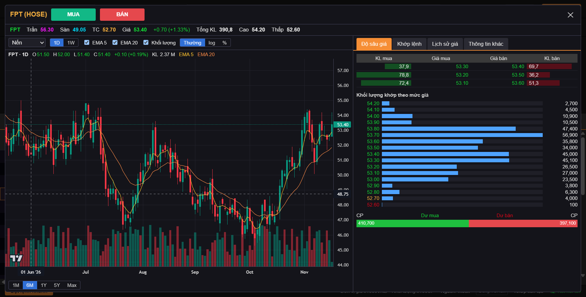

# Price Board Demo

Bảng giá chứng khoán realtime viết bằng React và TypeScript, chạy cùng một mock server trên máy. Dự án mô phỏng các màn hình thường gặp của một bảng giá: bảng giá theo tab sàn, dải chỉ số, đặt lệnh, sổ lệnh, đăng nhập và popup chi tiết mã có biểu đồ nến.

> **Lưu ý:** mọi giá, khối lượng, tài khoản và lệnh trong dự án đều là dữ liệu giả lập do mock server sinh ra. Dự án chỉ dùng để học và demo, không liên kết với công ty chứng khoán nào và không phải lời khuyên đầu tư.




## Tính năng

- **Bảng giá realtime:** 30 cột chia 5 nhóm (dư mua, khớp lệnh, dư bán, giá, nhà ĐTNN), giá nhận qua WebSocket, ô nháy màu khi số đổi.
- **Dải chỉ số:** bốn thẻ VNI, VN30, HNX, UPCOM có biểu đồ trong ngày (đường chỉ số đổi màu theo tham chiếu, cột khối lượng từng phút, rê chuột xem số), kèm bảng "Chỉ số chính" có thêm HNX30. Với mock, server tự tính chỉ số từ các mã của nó.
- **Tab sàn và danh mục quan tâm:** VN30, HNX, UPCOM; thêm hoặc bỏ mã khỏi danh mục, mỗi tab nhớ thứ tự và cách sắp xếp riêng.
- **Tuỳ biến bảng:** sắp xếp theo cột, kéo thả dòng, ẩn hiện cột, thu gọn dải chỉ số. Cấu hình lưu trong `localStorage`.
- **Đặt lệnh:** bấm đúp vào ô giá để mở form lệnh có sẵn giá; kiểm tra bước giá, lô, trần sàn, sức mua; có bước xác nhận.
- **Sổ lệnh:** xem, sửa, huỷ lệnh; tin khớp đẩy về qua WebSocket.
- **Đăng nhập giả lập:** token Bearer sống 8 giờ, mỗi tài khoản một phiên, server báo khi phiên hết hạn.
- **Popup chi tiết mã:** biểu đồ nến (Lightweight Charts) với EMA 5, EMA 20, khối lượng, nhiều kiểu biểu đồ và khung thời gian; bốn tab độ sâu giá, khớp lệnh, lịch sử giá, thông tin khác.
- **Hai nguồn giá qua một gateway:** mặc định là thị trường giả lập. Nút nhỏ ở chân trang chuyển sang giá thật của Yuanta (YSFlex). Cả hai nguồn đều đi qua server; trình duyệt không nối thẳng tới Yuanta (xem mục bên dưới).

## Chạy thử

Cần Node.js 20 trở lên.

```bash
npm install
```

```bash
npm run dev
```

Lệnh trên chạy mock server (cổng 8790) và Vite (cổng 4213) cùng lúc. Mở http://localhost:4213.

Đổi cổng mock server bằng biến môi trường `MOCK_PORT`.

### Tài khoản demo

| Tên đăng nhập | Mật khẩu |
| --- | --- |
| `demo` | `demo123` |
| `demo2` | `demo123` |
| `demo3` | `demo123` |

Đây là tài khoản giả, chỉ tồn tại trong `server/mock-users.ts`. Mock server chỉ có một tài khoản giao dịch, nên ba tên đăng nhập dùng chung số dư, danh mục và sổ lệnh.

### Các lệnh khác

| Lệnh | Việc làm |
| --- | --- |
| `npm test` | Chạy toàn bộ unit test (Vitest) |
| `npm run typecheck` | Kiểm tra kiểu TypeScript |
| `npm run build` | Kiểm tra kiểu rồi build bản production vào `dist/` |
| `npm run server` | Chỉ chạy server (đọc cổng từ `PORT` nếu có, như trên Render) |
| `npm run web` | Chỉ chạy Vite |

## Deploy

Giao diện là trang tĩnh, còn mock server cần chạy liên tục để giữ WebSocket và trạng thái trong bộ nhớ. Vì vậy hai phần deploy ở hai nơi:

| Phần | Nơi chạy | Cấu hình |
| --- | --- | --- |
| Server (gateway) | Render (Web Service) | Build `npm ci --include=dev`, Start `npm run server`. Server tự đọc cổng từ biến `PORT`. |
| Giao diện | Vercel | Preset Vite, giữ lệnh build mặc định. Biến môi trường `VITE_API_URL` là địa chỉ server trên Render. |

Khi có `VITE_API_URL`, giao diện gọi REST và WebSocket thẳng tới địa chỉ đó (server đã bật CORS). Mọi người xem dùng chung một thị trường giả lập và một tài khoản giao dịch.

Gói miễn phí của Render cho server ngủ khi không có người dùng, nên lần mở đầu có thể phải chờ khoảng một phút. Khi server ngủ, kết nối lên Yuanta cũng đóng; lúc thức dậy, gateway nối lại và tải lại lịch sử chỉ số khi có người chọn nguồn Yuanta.

## Nguồn giá Yuanta (YSFlex)

Yuanta cho phép dùng luồng giá realtime này trong phạm vi học tập, kể cả trên trang public.

Thêm `?nguon=ysflex` vào địa chỉ, hoặc bấm nút "Dùng YSFlex" ở chân trang, để xem giá thật. Ở chế độ này:

- server giữ **một** kết nối socket.io tới `/market` của Yuanta cho mọi người xem (`server/feed/ysflex.ts`); kết nối chỉ mở khi có người chọn nguồn này và đóng sau 60 giây không còn ai xem;
- chỉ có 30 mã VN30, tab HNX và UPCOM bị tắt;
- dải chỉ số lấy số thật trên cùng luồng: kênh `KRXMDDS|IGI` cho giá trị trực tiếp, yêu cầu `HIST_REQ` với `INTRADAY_1m` cho đường từ 9h (xem `server/feed/ysflex-index-map.ts`);
- chỉ đọc: không đăng nhập, không đặt lệnh; đặt lệnh chỉ có ở nguồn giả lập vì bộ khớp lệnh dùng giá giả lập.

Bấm "Dùng mock" để quay lại nguồn mặc định.

## Kiến trúc

```text
Yuanta /market (socket.io)          Thị trường giả lập
        |                                  |
  feed/ysflex.ts                     feed/mock.ts
        \                                /
         +---- Market Data Gateway -----+        server/ (Node.js, cổng 8790)
               - kiểm tra, chuẩn hoá về Quote
               - cache giá và chỉ số theo nguồn
               - mở/đóng nguồn theo người xem
                 |                 |
           REST /api/quotes     WebSocket /ws (tin QUOTE, INDEX)
                 \                 /
              Trình duyệt (React, cổng 4213; Vite chuyển tiếp /api và /ws)
```

Server còn có: `MarketSimulator` (sinh giá và khớp lệnh ngẫu nhiên theo bước giá), `MarketIndexes` (tính VNI, VN30, HNX, UPCOM, HNX30 cho nguồn giả lập), `OrderEngine` (nhận, sửa, huỷ, khớp lệnh), `AuthStore` (cấp và kiểm tra token), `candles` (nến lịch sử theo mã).

- Mỗi nguồn là một adapter cùng hợp đồng (`shared/feed.ts`). Gateway chỉ gửi những trường thật sự đổi, bỏ tin có số không hợp lệ, và gửi ngay ảnh chụp từ cache khi một tab đăng ký, nên mở trang không phải chờ tin mới.
- Giá đi một chiều từ server qua WebSocket vào `quote-store`. Mỗi ô chỉ đăng ký đúng mã nó cần (`useSyncExternalStore`), nên một lần khớp không vẽ lại cả bảng.
- Lệnh đi qua REST có gắn token; kết quả khớp đẩy về qua WebSocket và gộp vào `account-store`.
- Biểu đồ nạp lịch sử một lần bằng `setData`, sau đó chỉ cập nhật cây nến cuối theo giá realtime.
- Kiểu dữ liệu và luật nghiệp vụ dùng chung (bước giá, lô, kiểm tra lệnh, tính danh mục) nằm trong `shared/`, có test riêng.

### API của gateway

| API | Trả về |
| --- | --- |
| `GET /api/quotes?feed=mock\|ysflex&symbols=FPT,VCB` | Giá mới nhất trong cache (bỏ `symbols` để lấy mọi mã của nguồn) |
| `GET /api/quotes/:symbol?feed=` | Giá của một mã, 404 nếu chưa có |
| `GET /api/index-intraday/:code?feed=` | Điểm theo phút của chỉ số (VNI, VN30, HNX, UPCOM) |
| `GET /api/feed-status` | Trạng thái từng nguồn: kết nối, số tin, số tin bị loại, số lần nối lại, số người xem |

WebSocket `/ws`: gửi `{ "op": "sub", "symbols": [...], "feed": "ysflex" }`, nhận tin `QUOTE` (phần thay đổi của giá một mã) và `INDEX`.

## Cấu trúc thư mục

```text
price-board-demo/
├── index.html
├── src/
│   ├── main.tsx, app.tsx      Điểm vào và bố cục trang
│   ├── components/            Thanh trên, menu, dải chỉ số, bảng giá, hộp thoại, sổ lệnh, biểu đồ
│   ├── hooks/                 State của App tách theo việc: cấu hình bảng, danh mục, form lệnh, sổ lệnh
│   ├── lib/                   Kho dữ liệu, nguồn giá, định dạng số, logic form lệnh (kèm test)
│   ├── net/                   Client WebSocket và REST
│   └── styles/                CSS của bảng và bố cục
├── server/                    Server: gateway, thị trường giả lập, khớp lệnh, đăng nhập, nến
│   ├── gateway/               Cache giá và chỉ số theo nguồn, vòng đời các nguồn
│   └── feed/                  Adapter của từng nguồn (mock, Yuanta)
├── shared/                    Giao thức tin nhắn và luật nghiệp vụ dùng chung
├── scripts/browser-checks/    Script kiểm tra giao diện, dán vào console của trang đang chạy
└── docs/                      Ảnh chụp màn hình
```

## Kiểm tra giao diện

Thư mục `scripts/browser-checks/` chứa các script chạy ngay trong trang (dán vào DevTools console). Mỗi script trả về danh sách `{ id, pass, detail }`:

- `check-layout.js`: thứ tự vùng, tiêu đề cột, màu ô, số dòng;
- `check-interactions.js`: chọn dòng, sắp xếp, kéo thả;
- `check-tabs.js`: tab sàn và danh mục quan tâm;
- `check-order-form.js`: form đặt lệnh;
- `check-order-flow.js`, `check-order-book.js`: đọc trạng thái lệnh và sổ lệnh, không tự bấm.

Nên xoá `localStorage` rồi tải lại trang trước khi chạy để có cấu hình mặc định.

## Công nghệ

React 19, TypeScript 5.8, Vite 6, Vitest 3, Lightweight Charts 5 (TradingView, Apache-2.0), `ws` và `tsx` cho server, `socket.io-client` cho kết nối từ server tới Yuanta.
